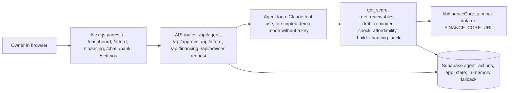

# Technical overview

## Architecture

## How the agent works
- `/api/agent` streams NDJSON events (step, text, tool, draft, link, done, error). The browser renders them as step indicators, streamed text, draft cards and links.
- With `ANTHROPIC_API_KEY`: a Claude tool-use loop (`lib/agent.ts`). The system prompt says: answer only from tool data, cite numbers, keep answers short.
- Without a key: `lib/demoAgent.ts` picks a scripted flow by keywords and calls the same tools, so every number comes from the demo data. The UI shows a small "Demo mode" label.
- `draft_reminder` only writes a draft to `agent_actions` (status `drafted`). `/api/approve` moves it to `approved` or `rejected` once. Nothing is ever sent.
- "Can I afford it?" (`lib/affordability.ts`): 13-week cash forecast from open invoices, each buyer's usual lateness, costs and sales. Compares no purchase, paying cash, and loan plus chasing late buyers. Payback uses an assumed extra profit of 2.5% of the price per month.
- Financing (`lib/offers.ts`): three fictional bank offers and one grant match, labelled "Demo offers". Sharing the Passport and requesting an adviser call are owner clicks, logged as `passport_shared` and `adviser_requested`.

## Logging
Every tool call and every owner decision is a row in `agent_actions` (type, payload, status). `npm run export-log` writes `evidence/execution-log.json`.

## Score algorithm
The health score (0 to 100, red to green) comes from **finance-core by Wojciech Pazoła** (`score.py`, `SPEC.md` section 4). It is plain arithmetic: **deterministic, no AI, no randomness**. The same data always gives the same score, and every sentence in it is filled from fixed templates with real numbers.

**Sub-scores.** Each metric is mapped to 0 to 100 on a straight line between two anchors and clamped.

| Sub-score | Measures | Computed as | 100 at | 0 at | Weight |
|---|---|---|---|---|---|
| Payment delays | How late customers pay | Amount-weighted mean of days past due for sales invoices paid in the last 90 days | 0 days | 45 days | 25% |
| Overdue share | How much of what is owed is late | Unpaid sales past due / all unpaid sales at the data date | 0% | 50% | 25% |
| Cash runway | How long cash lasts | Bank balance / average monthly outgoing payments, last 3 full months | 2 months | 0 | 20% |
| Gross margin | Profit on sales | (sales net - purchases net) / sales net, last 3 full months | 20% | 0% | 15% |
| Biggest-buyer share | Dependence on one buyer | Largest buyer's net sales / total net sales, last 12 months | 15% | 60% | 15% |

Trend penalties: payment delays lose 10 points if the 90-day average is more than 5 days worse than the 90 days before; margin loses 15 points if it is more than 3 points below the 3 months before. An invoice counts as paid on the booking date when the money referencing it (partial payments included, net of credit notes) reaches its gross amount.

**Total.** The weighted sum, rounded half up. Without bank data, cash runway has no score and weight 0, and the other weights are divided by 0.8 (31.25 / 31.25 / 18.75 / 18.75).

**Bands.** 0 to 39 red, 40 to 69 amber, 70 to 100 green.

**Reasons (up to 3).** One sentence for each of the two lowest sub-scores (ties keep the table order), such as "3 buyers pay more than 20 days late on average, with PLN 412,300 overdue." or "Cash covers about 5 weeks of outgoing payments." A third is added when one of the top 5 buyers by sales is paying later every month.

**Data trust.** *High*: at least 80% of sales value is from KSeF e-invoices and bank data is connected. *Medium*: bank data is connected and most sales come from KSeF or accounting records. *Low*: anything else, such as mostly uploaded PDFs or no bank data. It comes with one explaining sentence.

**How the app uses it.** With `FINANCE_CORE_URL` set, `lib/financeCore.ts` asks finance-core for the score (`POST /score`) and the dashboard, copilot and Passport show that result. Without it (mock mode) the app scores a fixed snapshot of finance-core's demo company (`lib/hydromatProfile.json`, built by `scripts/hydromat-profile.mjs` from `demo_amber.json`) with a simplified stand-in in `lib/financeCore.ts`, so the number can differ from finance-core's. The adapter between the app's profile type and finance-core's schema (amounts in grosze) is not wired yet. The copilot never computes or changes the score; it only reads it and quotes it.

## Tests
`npm test` covers `/api/agent` (demo mode), `/api/approve` and the affordability model.
