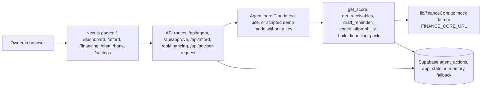

# Technical overview

## Architecture

## How the agent works
- `/api/agent` streams NDJSON events (step, text, tool, draft, link, done, error). The browser renders them as step indicators, streamed text, draft cards and links.
- With `ANTHROPIC_API_KEY`: a Claude tool-use loop (`lib/agent.ts`). The system prompt says: answer only from tool data, cite numbers, keep answers short.
- Without a key: `lib/demoAgent.ts` picks a scripted flow by keywords and calls the same tools, so every number comes from the demo data. The UI shows a small "Demo mode" label.
- `draft_reminder` only writes a draft to `agent_actions` (status `drafted`). `/api/approve` moves it to `approved` or `rejected` once. Nothing is ever sent.
- "Can I afford it?" (`lib/affordability.ts`): 13-week cash forecast from open invoices, each buyer's usual lateness, costs and sales. Compares no purchase, paying cash, and loan plus chasing late buyers. Payback uses an assumed extra profit of 2.5% of the price per month.
- Financing (`lib/offers.ts`): three fictional bank offers and one grant match, labelled "Demo offers". Sharing the Passport and requesting an adviser call are owner clicks, logged as `passport_shared` and `adviser_requested`.

## Logging
Every tool call and every owner decision is a row in `agent_actions` (type, payload, status). `npm run export-log` writes `evidence/execution-log.json`.

## Score algorithm
_To be written by Wojciech. The mock in `lib/financeCore.ts` is a stand-in: five parts worth 20 points each._

## Tests
`npm test` covers `/api/agent` (demo mode), `/api/approve` and the affordability model.
